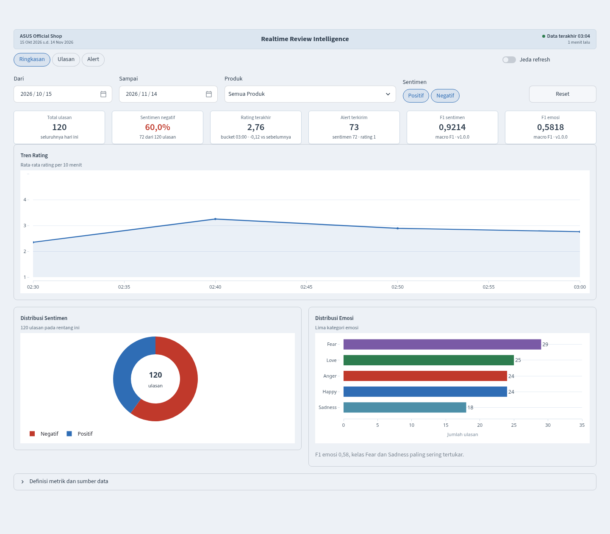

# Realtime Affective Analysis

Klasifikasi sentimen dan emosi ulasan e-commerce secara real-time, dari pengambilan data sampai dashboard dan notifikasi.



**Live demo:** [realtime-affective-analysis.streamlit.app](https://realtime-affective-analysis.streamlit.app/) memakai snapshot statis 14 November 2026. Pipeline lengkap di bawah berjalan lokal.

## Ringkasan

Ulasan toko di Shopee diambil lewat API, dialirkan ke Kafka, diproses dengan Spark Structured Streaming, disimpan di MongoDB, lalu perubahannya ditangkap Debezium dan diklasifikasi sentimen serta emosinya. Hasilnya masuk PostgreSQL, tampil di dashboard Streamlit, dan memicu alert.

Model dilatih terpisah di `ml/`, diekspor sebagai bundle berversi di `models/`, dan dimuat oleh service streaming lewat `manifest.json`. Versi model yang aktif ikut dicatat ke tabel `model_metadata`, sehingga angka F1 di dashboard selalu sesuai artifact yang sedang dipakai.

## Demo cepat

Prasyarat: Docker dengan Compose, sekitar 8 GB RAM. Stack ini menjalankan sekitar 12 container aktif.

```bash
git clone https://github.com/prayudahlah/realtime-affective-analysis.git
cd realtime-affective-analysis
cp .env.example .env
task demo
```

Buka:

- Dashboard: `http://localhost:8501`
- Kafka UI: `http://localhost:8082`
- Mongo Express: `http://localhost:8081`
- Spark Master: `http://localhost:8080`

Mode demo memakai `data/sample/reviews_sample.jsonl`, 120 ulasan yang sudah dianonimkan, jadi tidak perlu scraping atau cookie. Kalau `task` belum terpasang, jalankan `docker compose up -d --build` secara langsung.

Perintah lain:

| Perintah | Kegunaan |
|---|---|
| `task down` | Hentikan semua service |
| `task reset` | Hentikan dan hapus semua volume data |
| `task replay` | Kirim ulang sampel ke pipeline |
| `task train` | Latih ulang model dan tulis bundle baru |
| `task test` | Unit test dan validasi compose |
| `task lint` | Ruff untuk paket `ml` |

## Arsitektur

```text
Shopee API / sampel JSONL
        │
        ▼
   data-poller ──► Kafka "polled-data"
                        │
                        ▼
              Spark preprocess (normalisasi teks, TF-IDF, fitur dasar)
                        │
                        ▼
                 MongoDB (replica set)
                        │  Debezium CDC
                        ▼
             Kafka "cdc.mongodb.ecommerce.reviews"
                        │
                        ▼
          Spark inference (sentimen dan emosi)
                        │
                        ▼
                   PostgreSQL
                    ↙        ↘
              Streamlit    Trigger Telegram
```

Seluruh stack berjalan di satu node. Detail komponen, kontrak data, dan penanganan kegagalan ada di [docs/arsitektur.md](docs/arsitektur.md).

## Model

| Task | Algoritma | Fitur | CV macro F1 | Holdout macro F1 | Baseline |
|---|---|---|---|---|---|
| Sentimen | Logistic Regression, C=10 | TF-IDF 1500 + 11 fitur dasar | 0,9078 ± 0,0043 | 0,9214 | 0,3416 |
| Emosi | SMOTE + Logistic Regression, C=1 | TF-IDF 1500 + 11 fitur dasar + indikator sentimen | 0,6003 ± 0,0129 | 0,5818 | 0,0994 |

Bundle aktif ada di `models/sentiment/1.0.0/` dan `models/emotion/1.0.0/`. Setiap bundle berisi `model.joblib`, `vectorizer.joblib`, dan `metadata.json` yang mencatat hash dataset, hash split, urutan fitur, metrik per kelas, dan versi library.

Metrik lengkap, termasuk per kelas dan confusion matrix, ada di [docs/model-card.md](docs/model-card.md).

## Eksperimen

Protokol pemodelan sengaja diperbaiki sebelum hasil dilaporkan:

- Duplikat teks dibuang sebelum split, 112 baris.
- Pemilihan model memakai 5-fold CV di data latih, holdout hanya dievaluasi sekali.
- Indikator sentimen untuk model emosi memakai prediksi out-of-fold, bukan label asli, supaya kondisinya sama dengan saat serving.

Angka emosi turun dari 0,67 pada eksperimen awal menjadi 0,5818. Itu bukan regresi, melainkan efek protokol yang lebih jujur. Pembahasan lengkap ada di [docs/eksperimen.md](docs/eksperimen.md).

## Struktur repo

```text
ml/           pelatihan model, eksperimen, dan ekspor bundle
models/       bundle model berversi beserta metadata
streaming/    service pipeline, container, dan skrip
scripts/      utilitas pengembangan dan pembuat sampel
docs/         arsitektur, model card, dan catatan eksperimen
data/sample/  sampel data untuk demo
compose.yaml  orkestrasi seluruh service
```

## Limitasi

- Emosi adalah titik terlemah. Macro F1 0,5818, dengan Fear dan Anger paling sering tertukar.
- Model dilatih pada 5.400 ulasan e-commerce. Saat dipakai di toko lain, ada pergeseran domain.
- Alert belum punya status kerja seperti baru, ditangani, atau diabaikan.
- Satu ulasan negatif menghasilkan satu alert, jadi belum ada pengelompokan per produk atau jendela waktu.
- Stack hanya diuji pada satu node. Mode multi-node pernah ada, tetapi dihapus agar demo mudah dijalankan.
- Sampel replay adalah ulasan e-commerce umum yang dianonimkan, bukan data asli toko ASUS.

## Asal proyek

Repo ini menggabungkan dua tugas kuliah Semester 4, lalu dirapikan sebagai portofolio:

- [affective-computing-ecommerce](https://github.com/prayudahlah/affective-computing-ecommerce) untuk Rekayasa dan Organisasi Sistem Big Data. Menjadi dasar pipeline streaming: Kafka, Spark Structured Streaming, MongoDB, Debezium, PostgreSQL, dan Streamlit.
- [affective_classification_ecommerce](https://github.com/stringptr/affective_classification_ecommerce) untuk Penambangan Data. Menjadi dasar pelatihan model sentimen dan emosi, termasuk notebook eksperimen.

Di repo ini keduanya disatukan, model dilatih ulang dengan protokol yang diperbaiki, lalu artifact dikemas sebagai bundle berversi yang dibaca oleh service streaming.

Anggota kelompok:

- Anindya Artanti Pambudi (L0224002)
- Prayuda Afifan Handoyo (L0224008)
- Satria Manggala Putra Pratama (L0224024)
- Viola Herfina Putri (L0224026)

## Lisensi

MIT, lihat [LICENSE](LICENSE).
